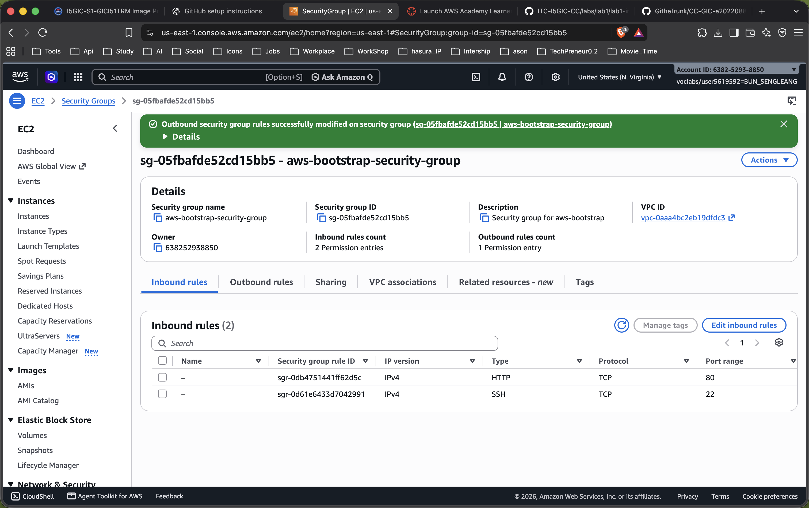
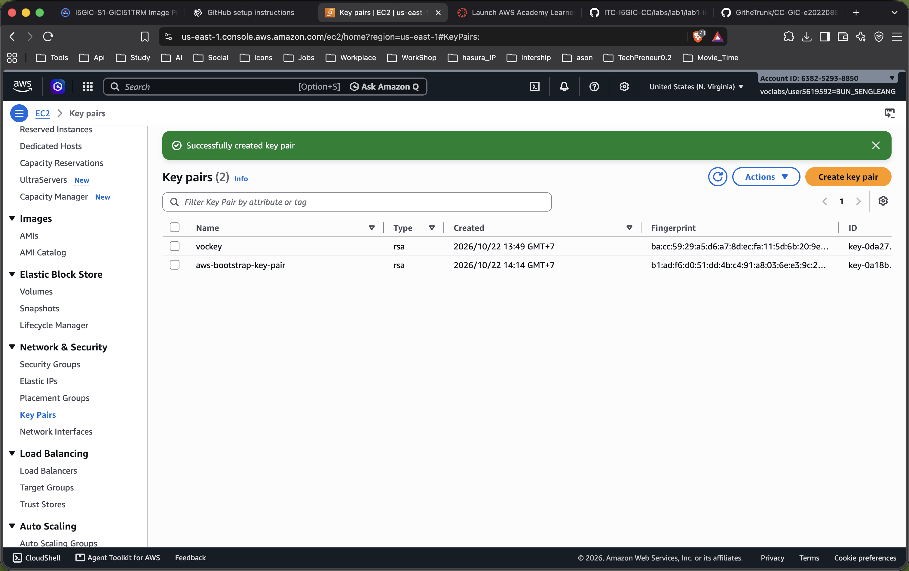
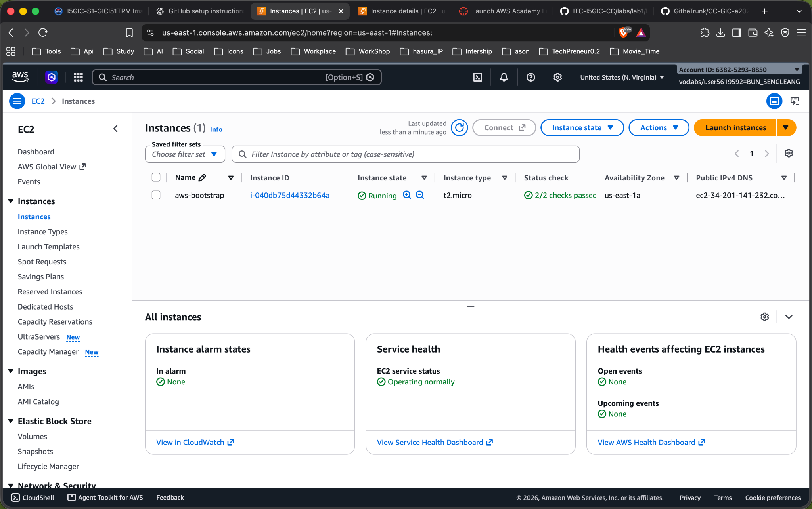
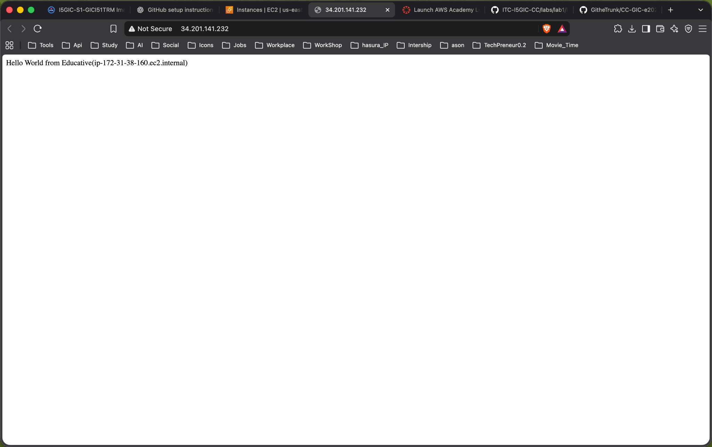
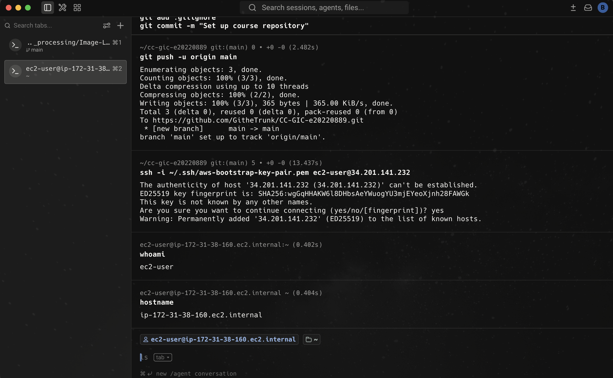
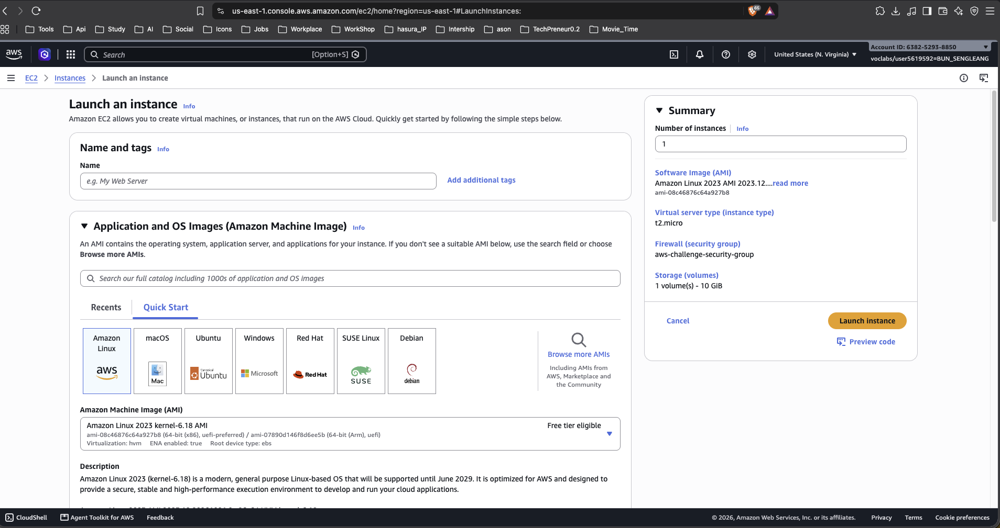
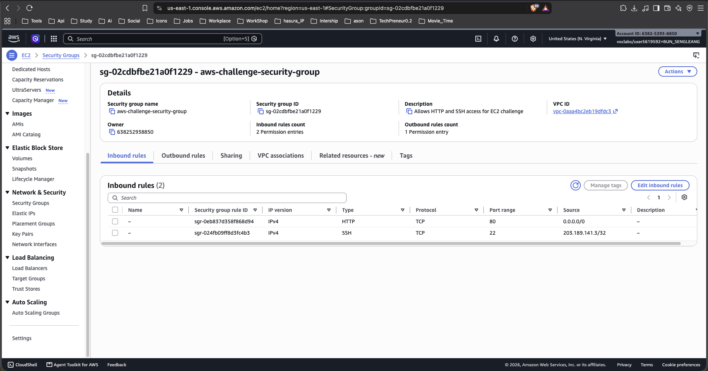
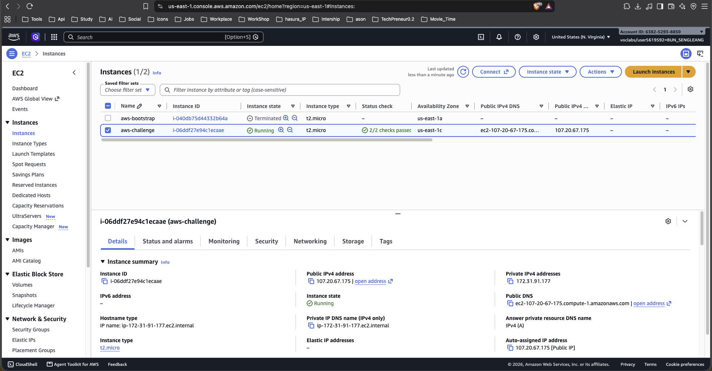
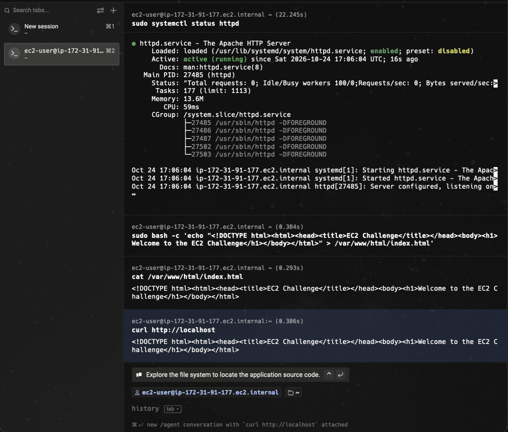
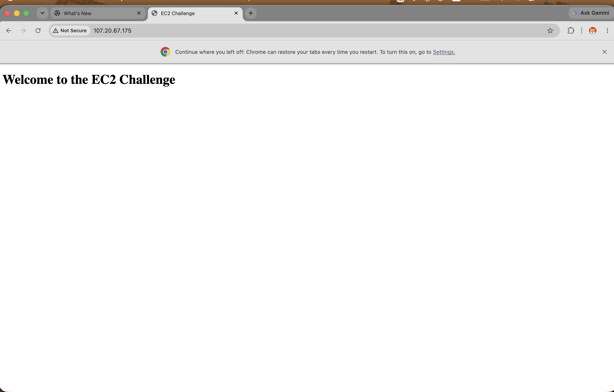

 # Cloud Lab 1 Submission: Amazon EC2

 | Field | Value |
 | --- | --- |
 | Student name | Bun Sengleang |
 | Student ID | `e20220889` |
 | Learner Lab username | `user56195952` |
 | Date completed | 2026-10-25 |

---

## Part 1.1 — An Amazon EC2 Walkthrough

### Security group



### Key pair



### Instance details



### Browser test



### SSH connection



I connected using my **own SSH client (terminal)** with the downloaded `.pem` key
pair.

---

## Part 1.2 — EC2 Web Solution (Challenge)

### Launch configuration



The challenge instance was configured with:

- **Instance type:** `t2.micro`
- **Operating system:** Amazon Linux 2023
- **Public IP:** Enabled
- **Root storage:** 10 GiB
- **Security group:** `aws-challenge-security-group`

### Security group



The security group contains two inbound rules:

- **HTTP:** TCP port `80`, source `0.0.0.0/0`
- **SSH:** TCP port `22`, source `203.189.141.3/32` (My IP)

### Running instance



The challenge instance was running with:

- **Instance type:** `t2.micro`
- **Public IPv4 address:** `107.20.67.175`
- **Availability Zone:** `us-east-1c`
- **Status checks:** `2/2 checks passed`

### Commands on the instance



The commands used to install and configure Apache and create the static web page were:

```bash
sudo dnf install -y httpd

sudo systemctl start httpd
sudo systemctl enable httpd
sudo systemctl status httpd

sudo bash -c 'echo "<!DOCTYPE html><html><head><title>EC2 Challenge</title></head><body><h1>Welcome to the EC2 Challenge</h1></body></html>" > /var/www/html/index.html'

cat /var/www/html/index.html
```

I also tested the web server from the instance:

```bash
curl http://localhost

sudo ss -lntp | grep :80

curl http://checkip.amazonaws.com

curl -I http://107.20.67.175
```

The Apache service was active and listening on port `80`, and the HTTP request returned `HTTP/1.1 200 OK`.

### Browser test



The page was successfully accessed at:

```text
http://107.20.67.175
```

The page displayed:

**Welcome to the EC2 Challenge**

---

## Questions

### 1. Your security group has an SSH rule and an HTTP rule. What does each one let you do? What would stop working if you deleted the HTTP rule?

The **SSH rule** allows me to remotely connect to the EC2 instance using SSH on TCP port `22`.

The **HTTP rule** allows users to access the web server through TCP port `80`.

If the HTTP rule were deleted, the Apache web server could still be running on the instance, but people from the internet would not be able to access the web page through HTTP.

### 2. In Part 1.1 you never logged in to install the web server. What installed it, and when did it run?

The web server was installed by the **EC2 User Data/bootstrap script** configured during instance launch. The script ran automatically when the EC2 instance started for the first time.

### 3. Why does the web page open with `http://` but not with `https://`?

The web server was configured for **HTTP on port 80**. HTTPS requires a web server configured for TLS/SSL, normally using port `443` and an SSL/TLS certificate.

Since HTTPS was not configured for this challenge, the page is available through:

```text
http://107.20.67.175
```

but not through:

```text
https://107.20.67.175
```

### 4. Part 1.2 asked for a 10 GiB root volume. Where in the launch settings did you set it, and how can you check the size on the running instance?

I set the root storage to **10 GiB** in the **Storage / Configure storage** section of the EC2 launch settings.

The size can be checked in the EC2 console under the instance's **Storage** tab. It can also be checked from the Linux terminal using:

```bash
lsblk
```

The root device should show approximately `10G`.

---

## Problems and how I solved them

During the challenge, the web page initially timed out when I tried to access the public IP from the browser.

I verified the problem step by step from the EC2 instance:

```bash
curl http://localhost
```

Apache returned the expected HTML page.

I then checked whether Apache was listening on port 80:

```bash
sudo ss -lntp | grep :80
```

The result showed that Apache was listening on:

```text
*:80
```

I also tested the public IP from inside the instance:

```bash
curl -I http://107.20.67.175
```

This returned:

```text
HTTP/1.1 200 OK
```

The security group was also checked and confirmed to allow HTTP traffic on
port `80` from `0.0.0.0/0`.

After retrying the public IP in Chrome, the page successfully loaded and displayed:

**Welcome to the EC2 Challenge**

---

## AI note

One suggestion from an AI tool was to verify the network path instead of reinstalling Apache. I checked this by verifying that Apache was listening on port 80, confirming the security group's HTTP rule, and testing the public IP with `curl`.

The final browser test confirmed that the EC2 web server was working correctly.

---

## Clean up

- **Part 1.1:** instance terminated, key pair deleted, and security group deleted.
- **Part 1.2:** instance terminated, security group deleted, and challenge key pair deleted.