# Cloud Lab 2 Submission — Load Balancer and Auto Scaling

- **Student name:** Bun Sengleang
- **Student ID:** `e20220889`
- **Learner Lab user name:** `user56195952`
- **Date completed:** 2026-11-01

---

## Security groups

The available screenshots show the load balancer security group and its later update, plus the launch template security group. The originally requested `01-sg-load-balancer.png` and `02-sg-launch-template.png` filenames are not present, so I linked the screenshots using their existing filenames.

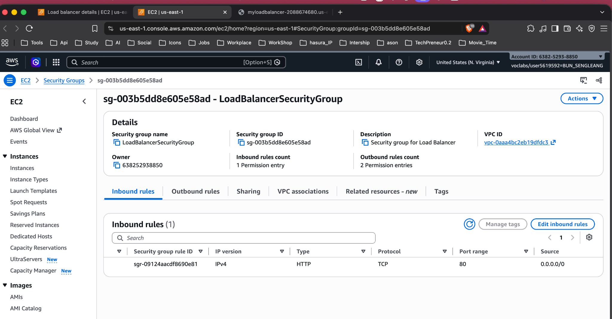

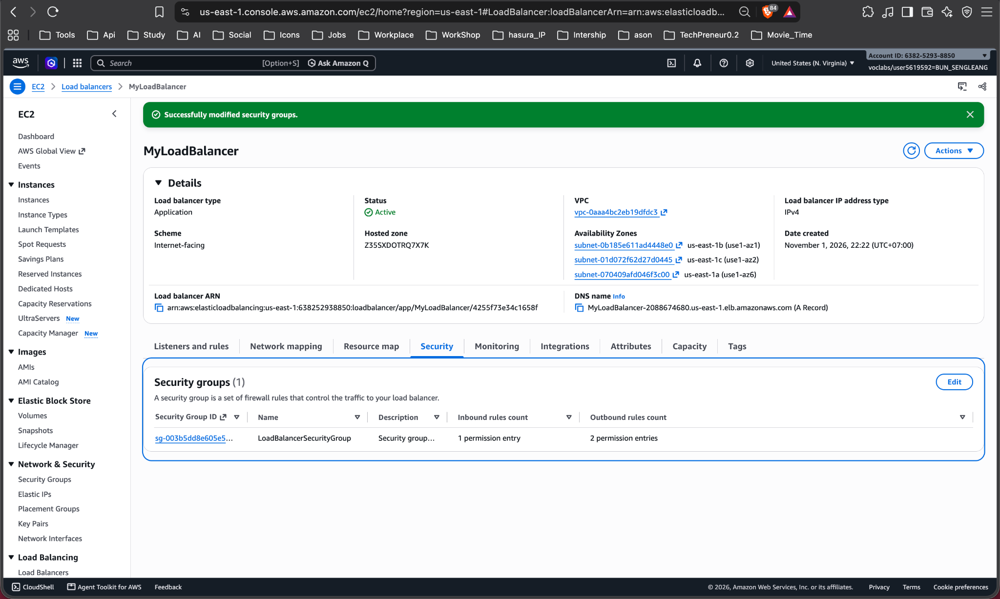

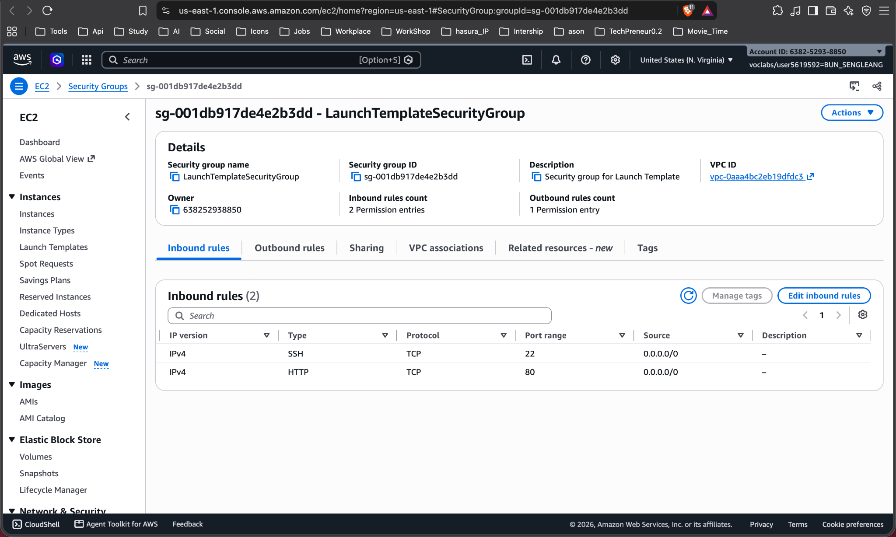

## Target group

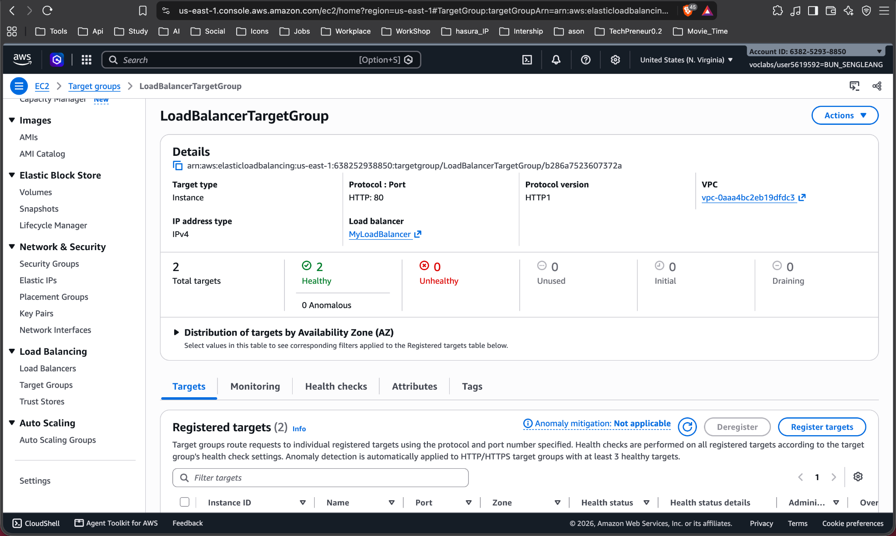

The target group health check settings screenshot (`04-health-checks.png`) is not present in the current images folder. The available screenshot shows target health after stopping `httpd`, rather than the health check configuration.

## Application Load Balancer

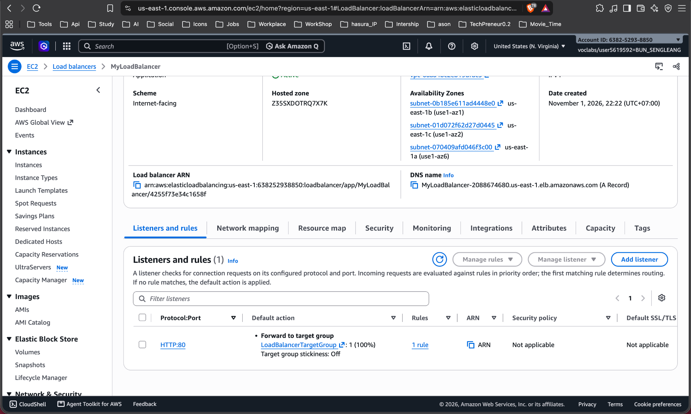

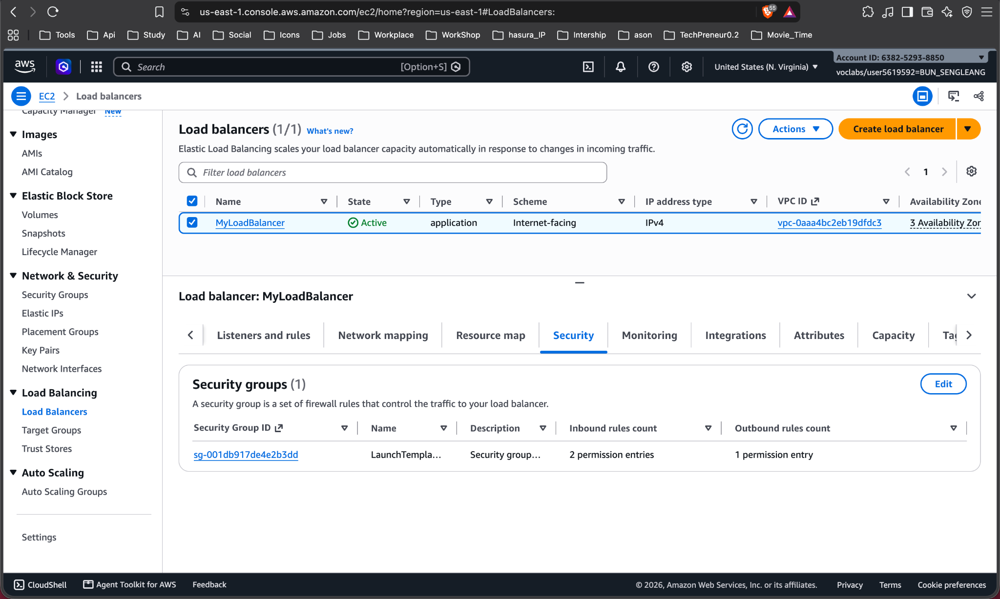

## Launch template

The required launch template details screenshot (`07-launch-template.png`) is not present. The available screenshot only shows the launch template security group.

## Auto Scaling group

The Auto Scaling group list and details screenshots (`08-asg-list.png` and `09-asg-details.png`) are not present in the current images folder.

## Load balancing test

The browser responses show the same load balancer address serving content from two different EC2 host names.

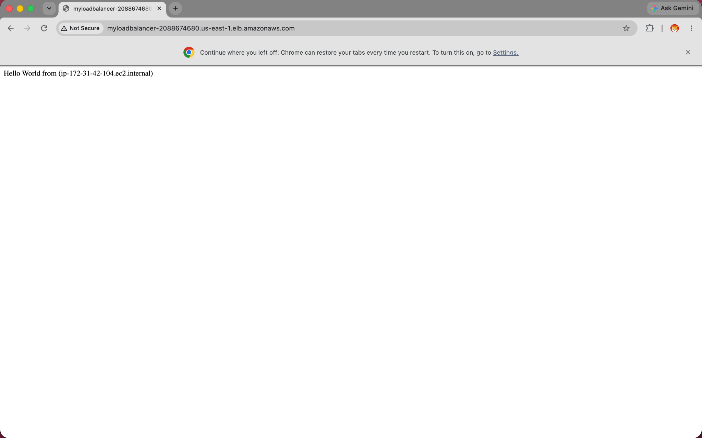

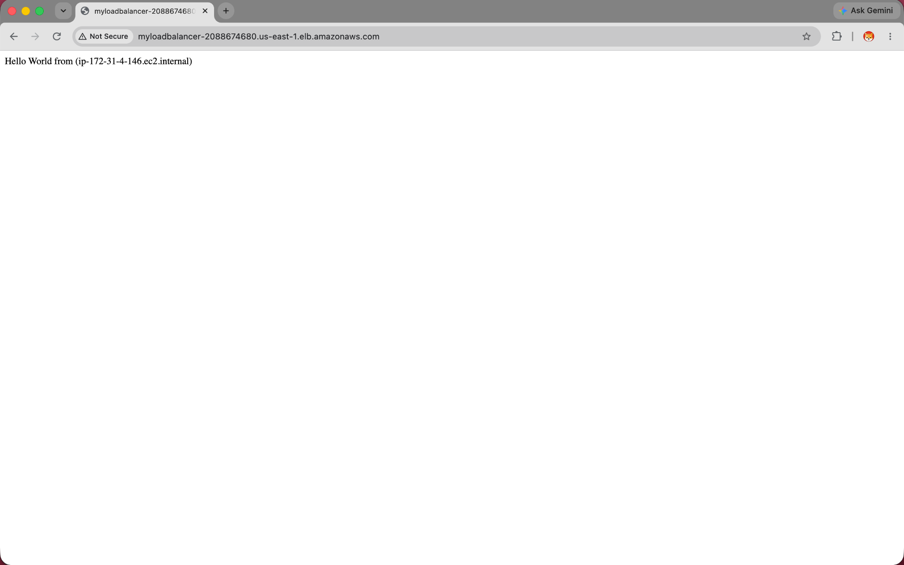

I also checked the load balancer with `curl`; it returned `HTTP/1.1 200 OK` and the page content from a backend instance.

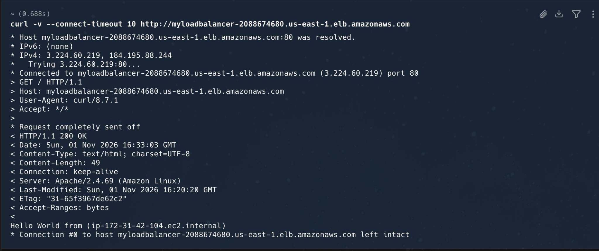

## Simulated application failure

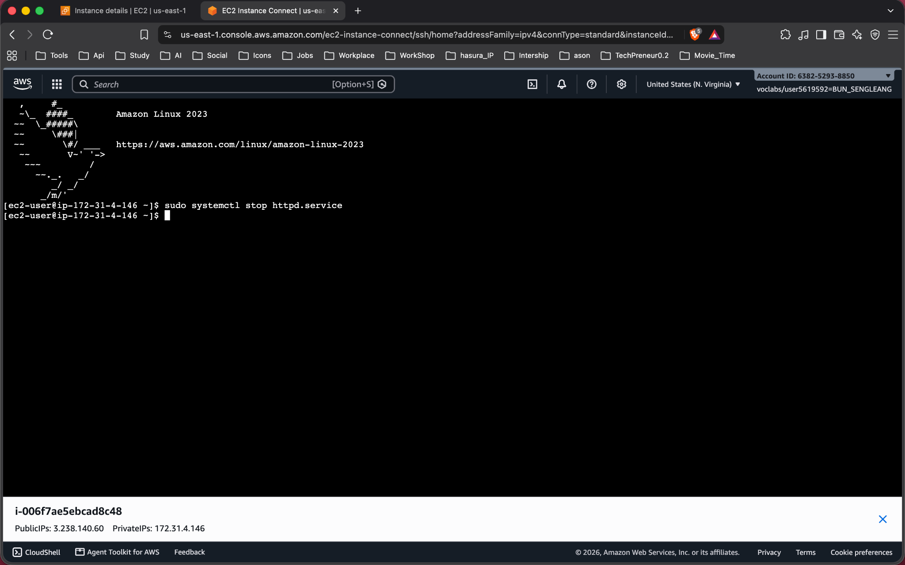

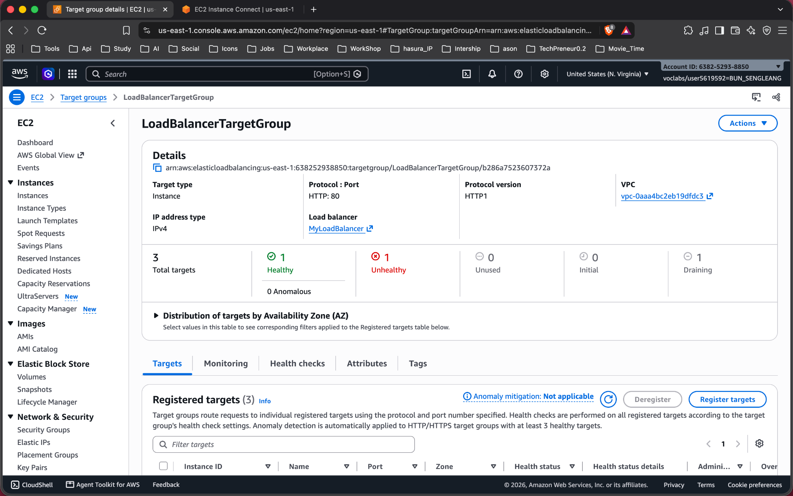

The target group screenshot shows one healthy target, one unhealthy target, and one draining target. The final required screenshot showing the replacement target healthy (`14-target-replaced.png`) is not present, so the available evidence does not confirm the completed replacement.

**About how many minutes passed between stopping `httpd` and the new instance becoming healthy?** The available screenshots do not record the time when the replacement became healthy. Add the elapsed time after checking your AWS console history or notes.

---

## Questions

1. **Why does the page show a different host name when you refresh it?**

   The Application Load Balancer forwards requests to registered healthy instances in its target group. Each instance serves a page containing its own hostname, so requests routed to different instances show different host names.

2. **After you stopped `httpd`, the instance was still *running* in EC2, but the target group marked it *unhealthy*. What did the health check test, and why did the instance fail it?**

   The target group's HTTP health check requests the configured path (normally `/`) on the instance's registered port (HTTP port 80). Stopping `httpd` prevents the instance from serving that request successfully, so it fails the health check even though the EC2 instance itself remains running.

3. **Who replaced the failed instance: the load balancer, the target group, or the Auto Scaling group? Explain the role of each one.**

   The **Auto Scaling group** replaces the failed instance to maintain its desired capacity. The **target group** checks target health and reports unhealthy targets. The **load balancer** routes requests to healthy targets and stops sending traffic to unhealthy ones.

4. **With desired 2, minimum 2 and maximum 3, how many instances run normally? In what situation could there be 3?**

   Normally, two instances run. The group can temporarily have three while it launches a replacement for an unhealthy instance before the old instance is fully deregistered or terminated, within the maximum capacity of three.

5. **The instances' security group allows HTTP from anywhere. How could you change it so that the instances accept HTTP only from the load balancer?**

   Change the instances' security group inbound HTTP rule to use `LoadBalancerSecurityGroup` as its source instead of `0.0.0.0/0`. Keep public HTTP access on the load balancer's security group; the instances then accept HTTP only from resources associated with that load balancer security group.

## Problems and how I solved them (optional)

The load balancer initially timed out. I updated its security group and then verified that a request returned `HTTP/1.1 200 OK` and that browser requests reached both backend instances.

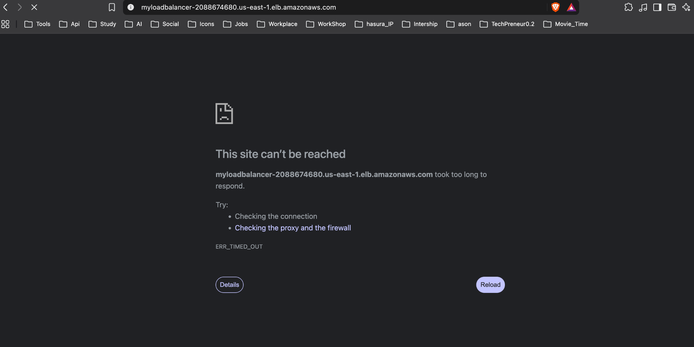

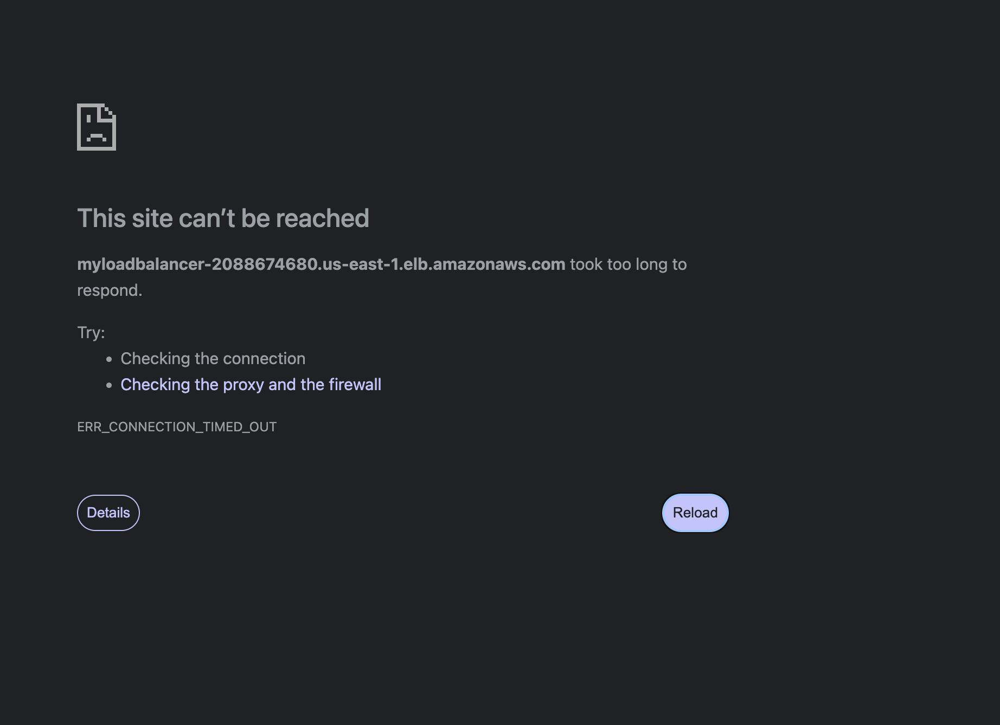

## AI note (optional)

## Clean up

- [ ] `MyAutoScalingGroup` deleted and its instances terminated.
- [ ] `AutoScalingLaunchTemplate` deleted.
- [ ] `MyLoadBalancer` and `LoadBalancerTargetGroup` deleted.
- [ ] Both security groups deleted.
