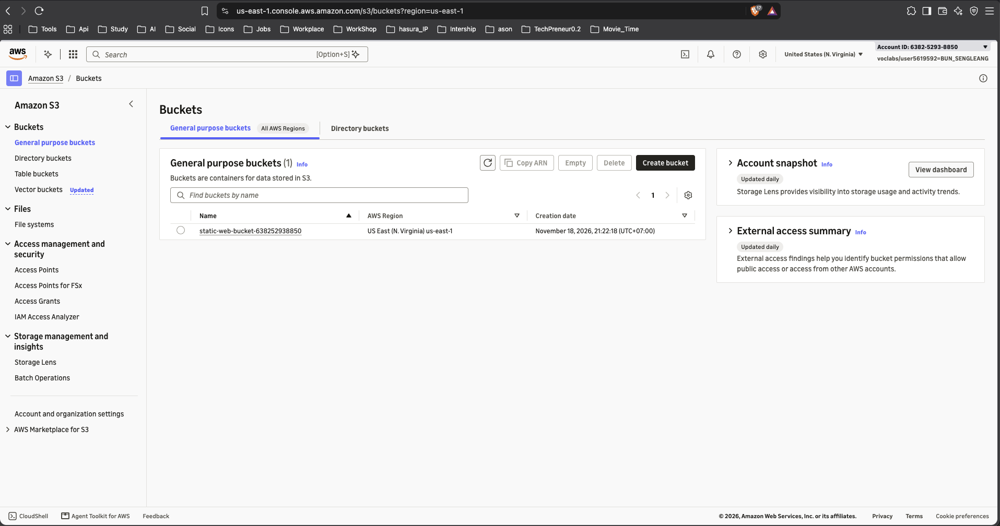
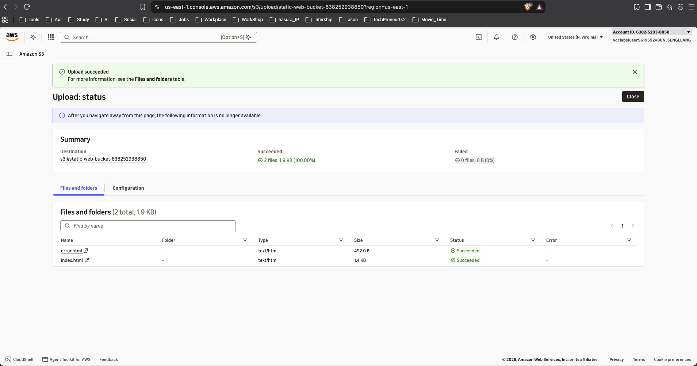
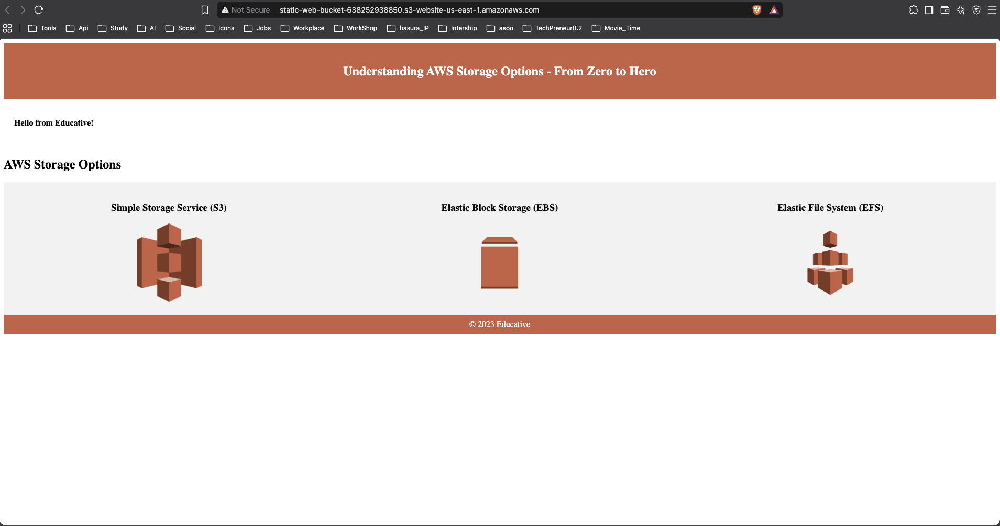
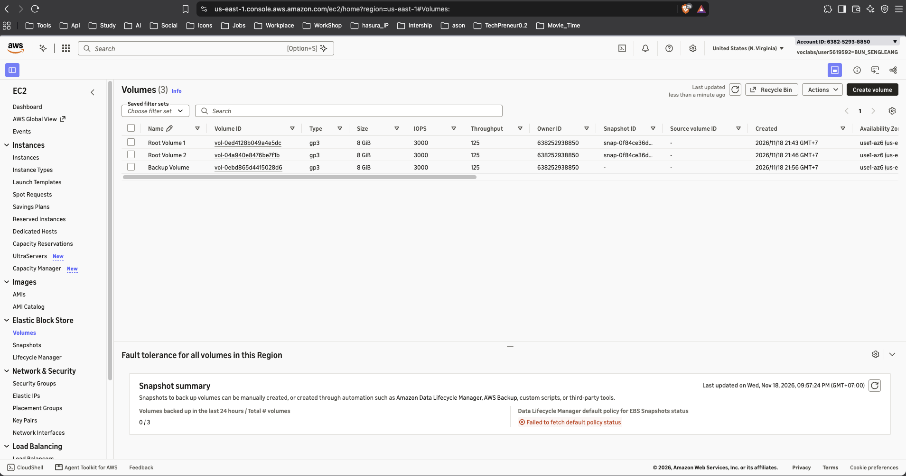
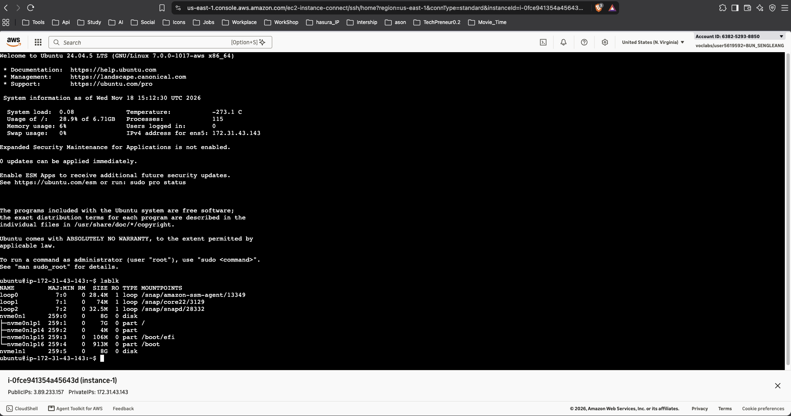
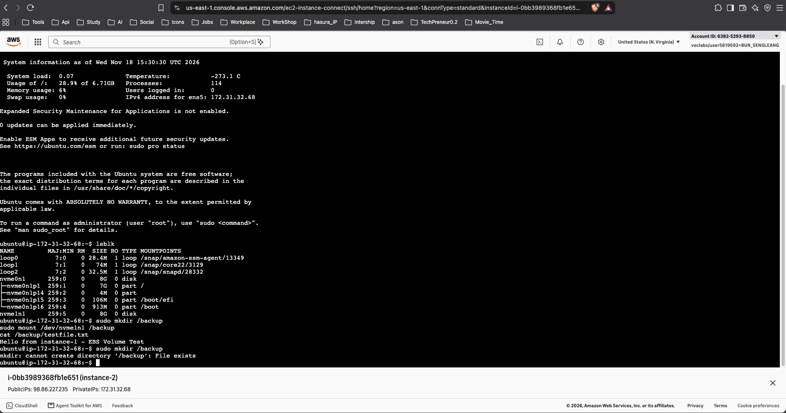
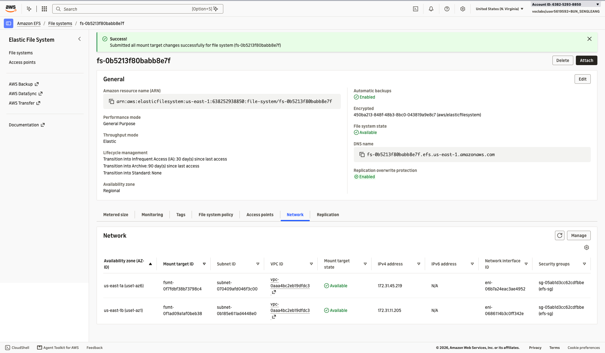
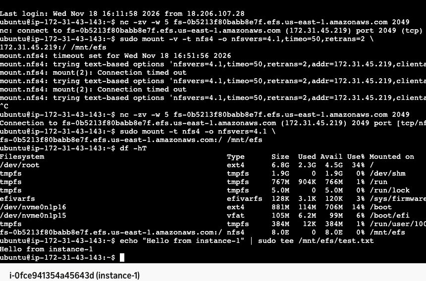
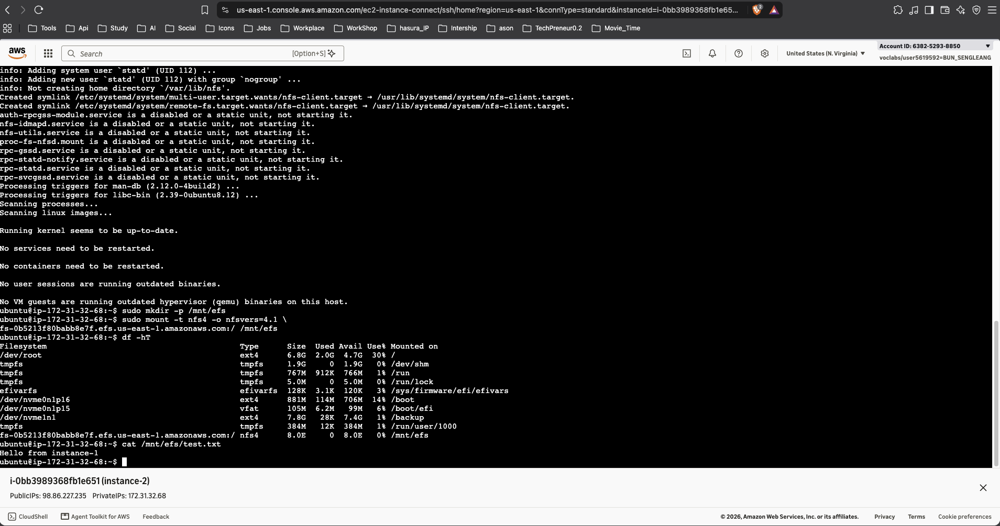

# Cloud Lab 3 Submission — AWS Storage Options

- **Student name:** BUN Sengleang
- **Student ID:** e20220889
- **Learner Lab user name:** `BUN_SENGLEANG`
- **Date completed:** 18 November 2026

---

## Part 2.1 — Amazon S3

### Bucket list



Bucket created: `static-web-bucket-638252938850` in `us-east-1`.

### Uploaded files



The S3 upload status confirms that both `index.html` and `error.html` were uploaded successfully.

### Static website



The static website displayed the **Understanding AWS Storage Options - From Zero to Hero** page after the bucket's public-read access was configured.

---

## Part 2.2 — Amazon EBS

### Volumes page



Created an 8 GiB `gp3` volume named **Backup Volume** in `us-east-1a` and attached it to `instance-1`. The volume list screenshot shows the created volume alongside the two root volumes.

### Attached volume (`lsblk`)



**Device name:** `/dev/nvme1n1` (the Linux NVMe device shown by `lsblk`).

The device was formatted as `ext4`, mounted at `/backup`, and used to store `testfile.txt`.

### File read on instance-2



After detaching **Backup Volume** from `instance-1` and attaching it to `instance-2`, I mounted it at `/backup` and read the existing file.

The file content was:

```text
Hello from instance-1 - EBS Volume Test
```

---

## Part 2.3 — Amazon EFS

### File system and mount targets



EFS file system ID: `fs-0b5213f80babb8e7f`

The Network tab shows mount targets in `us-east-1a` and `us-east-1b`. The EFS DNS name used was:

```text
fs-0b5213f80babb8e7f.efs.us-east-1.amazonaws.com
```

### File created on instance-1



After mounting EFS at `/mnt/efs`, I created `test.txt` on `instance-1`:

```bash
echo "Hello from instance-1" | sudo tee /mnt/efs/test.txt
```

### File listed on the second instance



I mounted the same EFS file system on `instance-2` and read `test.txt`. The output was:

```text
Hello from instance-1
```

**Difference from the lab handout:** The handout asks for the EFS read test on `instance-3`, placed in `us-east-1b`. My shared screenshots show the read test on `instance-2` instead. The screenshots verify shared access between `instance-1` and `instance-2`, but do not verify the required `instance-3` test.

---

## Questions

### 1. After you turned on static website hosting, the endpoint first answered 403 Forbidden. Why, and what changed after you added the bucket policy?

The website endpoint initially returned **403 Forbidden** because the objects were not publicly readable. Enabling static website hosting only configured S3 to serve the website; it did not grant visitors permission to read the files. The bucket policy allowed `s3:GetObject` for the bucket objects, so visitors could retrieve `index.html` and the other website files. The website then loaded successfully.

### 2. `testfile.txt` was still there after you moved Backup Volume to instance-2. What would have happened to a file saved on instance-1's root volume after terminating instance-1?

The file on **Backup Volume** remained because the additional EBS volume persists independently of the EC2 instance and can be detached and attached to another compatible instance. A file saved only on `instance-1`'s root volume would normally be deleted when `instance-1` was terminated, because the root volume is configured for deletion on termination by default.

### 3. Why did you run `mkfs` on instance-1 but not on instance-2?

I ran `mkfs` on `instance-1` because the new EBS volume was raw storage and did not yet have a file system. `mkfs` created the `ext4` file system. I did not run it again on `instance-2` because the existing file system and its data were already on the volume. Running `mkfs` again would create a new file system and erase the existing data.

### 4. Why could instance-1 and instance-3 use the EFS file system at the same time, when an EBS volume had to be detached first? Why did they have to be in the subnets of the mount targets?

EFS is a shared network file system that supports simultaneous access from multiple EC2 instances through NFS. EBS is block storage attached to an instance; in this lab, the same EBS volume had to be detached from one instance before it was attached to the other.

EFS mount targets provide network endpoints for instances to connect to the file system. The instances must be placed in the appropriate subnets/Availability Zones where mount targets are available so they can reach EFS through the VPC network.

**My actual test:** The screenshots show simultaneous EFS access from `instance-1` and `instance-2`. I did not capture the handout's requested `instance-3` test.

### 5. For each need, choose S3, EBS or EFS and give one reason.

- **(a) A website's images — S3:** It stores objects such as image files and can serve them over the web.
- **(b) The disk of a database server — EBS:** It provides block storage that can be attached to an EC2 instance and formatted with a file system.
- **(c) A folder shared by several web servers — EFS:** Multiple instances can mount and access the same file system at the same time.

---

## Problems and how I solved them (optional)

- **S3 website returned 403 Forbidden:** Static website hosting was enabled, but public object access was not yet allowed. I added a bucket policy allowing `s3:GetObject` for the bucket objects. The website then loaded.
- **EFS NFS connection timed out:** The initial connection test to TCP port `2049` timed out. I reviewed the security groups and configured the EFS security group to allow inbound NFS traffic from the EC2 instances' security group. I then tested connectivity with `nc` and mounted EFS successfully.
- **Security group source validation:** Entering a security group ID as a CIDR/custom IP source produced a validation error. The EC2 security group needed to be selected as a referenced security group source instead of being entered as an IP/CIDR value.
- **EFS client package:** `nfs-common` was installed on the Ubuntu instances and the file system was mounted using NFS 4.1.

## AI note (optional)

An AI suggestion was to check whether TCP port `2049` was reachable from the EC2 instance to the EFS mount target. I checked it with `nc -zv` before and after adjusting the security group. The first test timed out; the later test succeeded, and the EFS mount worked.

## Clean up

The screenshots do not confirm that the following resources were deleted. Check each item in the AWS console and mark it only after verifying cleanup:

- [x] EC2 instances `instance-1`, `instance-2`, and `instance-3` terminated. (The shared screenshots show `instance-1` and `instance-2`; no `instance-3` evidence was provided.)
- [x] EFS file system `fs-0b5213f80babb8e7f` deleted.
- [x] EBS volume **Backup Volume** deleted.
- [x] Security groups `efs-sg` and `ec2instances-sg` deleted.
- [x] S3 bucket `static-web-bucket-638252938850` emptied and deleted.
